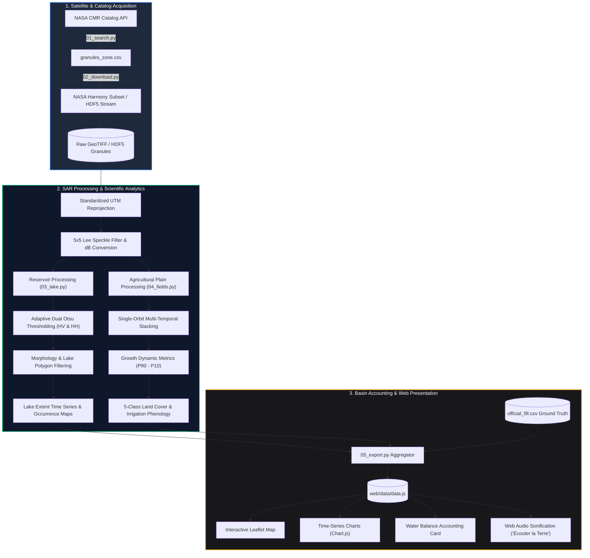
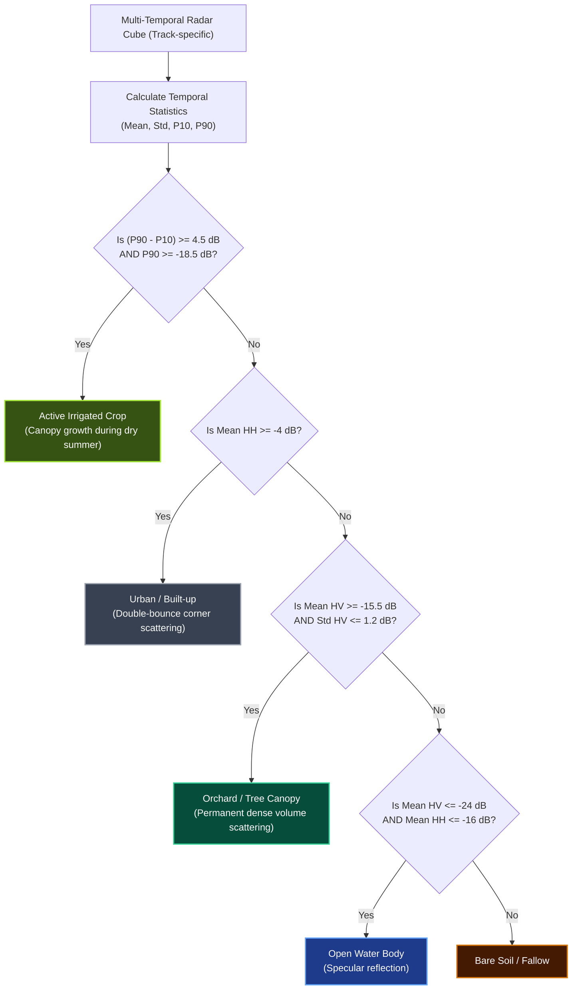

# NABD (نبض) — The Pulse of Morocco's Water

> **NASA Space Apps Challenge · Track: *Dancing with the SARs***  
> Monitoring reservoir supply and agricultural demand using **NASA-ISRO SAR (NISAR)** L-band Radar.

---

## 📌 Executive Summary

**NABD** (*"Pulse"* in Arabic — **نبض**) connects space radar technology directly to national water security. Focusing on the hyper-critical water basin of Morocco, NABD monitors the end-to-end water cycle: from **reservoir storage (supply)** down to **field-level crop irrigation (demand)**.

| Component | Target Area | Role in System | Radar Observation |
| :--- | :--- | :--- | :--- |
| **Al Massira Reservoir** | Settat / Rehamna (`32.47°N, -7.64°W`) | **Supply** | Water surface area evolution across satellite passes vs. national dam fill levels. |
| **Doukkala Plain** | Sidi Bennour / Zemamra (`32.75°N, -8.50°W`) | **Demand** | Crop canopy growth dynamics in hyper-arid summer conditions to identify active irrigation. |

In addition to visual Earth observation, NABD introduces an innovative **Data Sonification mode ("Écouter la Terre")**, translating radar backscatter time series into traditional Moroccan musical scales (Hijaz mode & Darbouka rhythm).

---

## 🗺️ System Architecture & Workflow Diagrams

### End-to-End Data Pipeline Architecture



### Reservoir Water Extraction Pipeline (Al Massira)


### Agricultural Parcel Phenology & Irrigation Classifier (Doukkala)



---

## 🛰️ Theoretical Background & Scientific Methods

NISAR (NASA-ISRO Synthetic Aperture Radar) operates in the **L-band (~24 cm wavelength)**, which penetrates dry soil, clouds, weather cover, and dense vegetation canopies more effectively than shorter optical or C-band wavelengths. NABD processes **NISAR Level-2 GCOV (Geocoded Polarimetric Covariance)** data (`HH` and `HV` polarization backscatter).

### 1. Water Surface Detection (Reservoir Supply)
* **Pre-processing:** Reprojection to a standardized metric UTM grid (`EPSG:32629`, 20 m resolution) and Lee Speckle Filtering ($5 \times 5$ window) to suppress SAR granular speckle noise.
* **Conversion to dB:** Linear power $\gamma^0$ converted via:
  $$\gamma^0_{\text{dB}} = 10 \cdot \log_{10}(\gamma^0)$$
* **Adaptive Dual-Polarization Otsu Thresholding:**
  Water acts as a specular reflector (smooth surface reflecting radar signals away from satellite sensors), resulting in low backscatter:
  $$\text{Water} = \left( \gamma^0_{\text{HV}} < T_{\text{HV}} \land \gamma^0_{\text{HH}} < T_{\text{HH}} \right) \lor \left( \gamma^0_{\text{HV}} < T_{\text{HV}} - 4\,\text{dB} \right)$$
  *Automatic threshold boundaries:* $T_{\text{HV}} \in [-32, -18]\,\text{dB}$ and $T_{\text{HH}} \in [-26, -12]\,\text{dB}$.
* **Morphological Cleaning & Filtering:** Binary opening followed by small hole/object suppression ($<25$ pixels / $1\text{ ha}$) and contiguous water body filtering ($>0.25\text{ km}^2$).
* **Water Occurrence & Dynamics:** Multi-temporal tracking reveals baseline water reserves vs. seasonal shoreline recession.

### 2. Crop Growth & Irrigation Mapping (Agricultural Demand)
* **Single-Orbit Invariant Geometry:** All time-series observations are constrained to single orbital tracks (e.g., Track `044`) to eliminate incidence angle variations.
* **Summer Growth Inversion:** Summer in Doukkala is dry and cloud-free with near-zero precipitation. Any systematic rise in cross-polarization backscatter ($\gamma^0_{\text{HV}}$) signifies volume scattering from developing plant stems and foliage—providing clear evidence of irrigation:
  $$\Delta \gamma^0_{\text{HV}} = P_{90}(\gamma^0_{\text{HV}}) - P_{10}(\gamma^0_{\text{HV}}) \ge 4.5\,\text{dB} \quad \text{and} \quad P_{90} \ge -18.5\,\text{dB}$$
* **Multi-Class Land Surface Classification:**
  1. **Water:** Mean $\gamma^0_{\text{HV}} \le -24\,\text{dB}$ and $\gamma^0_{\text{HH}} \le -16\,\text{dB}$.
  2. **Urban / Built-up:** High double-bounce corner reflection (Mean $\gamma^0_{\text{HH}} \ge -4\,\text{dB}$).
  3. **Perennial Trees / Orchards:** Constant high volume scattering ($\mu_{\text{HV}} \ge -15.5\,\text{dB}$ with $\sigma_{\text{HV}} \le 1.2\,\text{dB}$).
  4. **Active Summer Crops (Irrigated):** Dynamic backscatter swing exceeding vegetative growth thresholds.
  5. **Bare Soil / Fallow:** Low backscatter variations throughout the season.

### 3. Integrated Basin Water Balance
Correlating satellite-measured water surface contraction ($\Delta A_{\text{lake}}$) with official dam volume discharge records ($\Delta V_{\text{official}}$ in $\text{Mm}^3$) and active irrigated acreage ($\text{km}^2$), offering policymakers a transparent water budget accounting framework.

---

## 🗂️ Project Repository Structure

```text
nisar-surface-change/
├── data/
│   ├── granules_massira.csv    # CMR query catalog entries for Al Massira
│   ├── granules_doukkala.csv   # CMR query catalog entries for Doukkala
│   ├── official_fill.csv       # Ground truth dam reservoir fill rates & volumes
│   ├── raw/                    # Downloaded / clipped GeoTIFF radar granules
│   └── work/                   # Intermediate analytical cubes and JSON outputs
├── scripts/
│   ├── config.py               # Coordinates, bounding boxes, thresholds & parameters
│   ├── common.py               # Projections, speckle filters (Lee), display encoders
│   ├── 00_make_demo.py         # Synthetic SAR scene generator for off-line evaluation
│   ├── 01_search.py            # NASA CMR API discovery client for NISAR scenes
│   ├── 02_download.py          # NASA Harmony bounding-box subsetter / HDF5 streamer
│   ├── 03_lake.py              # Surface water extraction pipeline (Otsu + morphology)
│   ├── 04_fields.py            # Temporal variance analysis for crop classification
│   └── 05_export.py            # Aggregator compiling outputs into web/data/data.js
├── web/
│   ├── index.html              # Interactive Dashboard (Leaflet + Chart.js + Web Audio)
│   ├── data/                   # Packaged dataset & raster overlays (WebP/PNG)
│   └── vendor/                 # Leaflet GIS vendor styles & scripts
├── app_demo.py                 # Streamlit exploration prototype
├── requirements.txt            # Python dependencies
└── RESSOURCES.md               # NASA Space Apps resource survey & documentation
```

---

## 🚀 Getting Started

### 1. Prerequisites & Environment Setup
Clone the repository and configure your Python virtual environment:

```bash
# Clone the repository
git clone https://github.com/your-username/nisar-surface-change.git
cd nisar-surface-change

# Set up virtual environment
python -m venv .venv

# Activate environment
# On Linux / macOS:
source .venv/bin/activate
# On Windows:
.venv\Scripts\activate

# Install required dependencies
pip install -r requirements.txt
```

### 2. NASA Earthdata Credentials
Accessing raw NISAR granules requires an approved [NASA Earthdata Login](https://urs.earthdata.nasa.gov/users/new).

Create or update your `~/.netrc` (or `%USERPROFILE%\_netrc` on Windows):
```text
machine urs.earthdata.nasa.gov login <YOUR_USERNAME> password <YOUR_PASSWORD>
```
*(This credential file is strictly personal and excluded via `.gitignore`.)*

---

## ⚙️ Running the Full End-to-End Pipeline

```bash
# Step 0: (Optional) Generate mock synthetic radar data to test offline
python scripts/00_make_demo.py

# Step 1: Query NASA CMR catalog for available NISAR granules
python scripts/01_search.py --zone massira
python scripts/01_search.py --zone doukkala

# Step 2: Download clipped spatial bounding boxes (spatially subset via NASA Harmony)
python scripts/02_download.py --zone massira
python scripts/02_download.py --zone doukkala --track 044

# Step 3: Extract reservoir water extent & compute surface timeseries
python scripts/03_lake.py --zone massira

# Step 4: Classify irrigated agriculture & crop calendars
python scripts/04_fields.py --zone doukkala

# Step 5: Package metrics and layers for the web UI
python scripts/05_export.py
```

---

## 🌐 Web Visualization & Interactive Exploration

Launch the local web server to explore the application:

```bash
python -m http.server -d web 8000
```
Open your browser at **`http://localhost:8000`**.

### Dashboard Features:
* **Interactive Spatio-Temporal Maps:** Switch seamlessly between Al Massira lake contours and Doukkala agricultural parcels.
* **Dual Layer Overlay:** Inspect calibrated radar amplitude (false color `HH`/`HV`) and automated classification masks.
* **Time-Series Charts:** Track water surface area fluctuations juxtaposed with official dam telemetry.
* **Audio Sonification ("Écouter la Terre"):** Click anywhere on the map to sonify the local SAR backscatter signature into microtonal musical rhythms.

---

## ⚖️ Scientific Considerations & Disclaimers

1. **Provisional NISAR Data:** Data products correspond to early provisional calibration releases (mid-to-late 2026).
2. **Wind Roughness Effects on Water:** High surface wind can increase SAR surface roughness and backscatter on water. NABD prioritizes `HV` polarization, which maintains superior contrast against wind-roughened open water.
3. **Indirect Irrigation Proxy:** Summer active vegetative growth strongly implies irrigation during dry Mediterranean summers, serving as an operational proxy rather than a direct meter reading.
4. **Water Budget Approximations:** Surface area-to-volume approximations omit localized evaporation dynamics, inter-basin transfers, and municipal drinking water abstractions.

---

## 📜 License & Acknowledgments
Developed for the **NASA Space Apps Challenge 2026**.  
Satellite data courtesy of **NASA / ISRO** distributed via **ASF DAAC**. Built using open-source geospatial tools: Rasterio, Scikit-Image, SciPy, Leaflet, and Chart.js.
