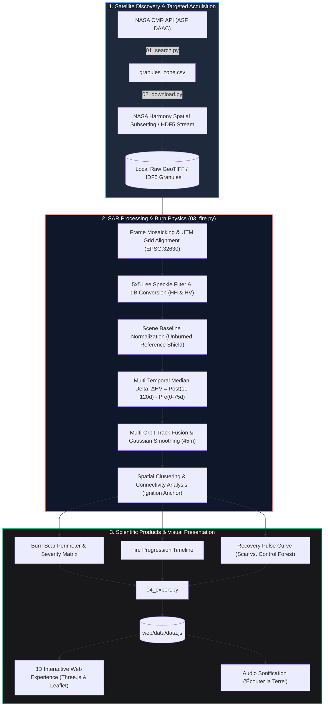
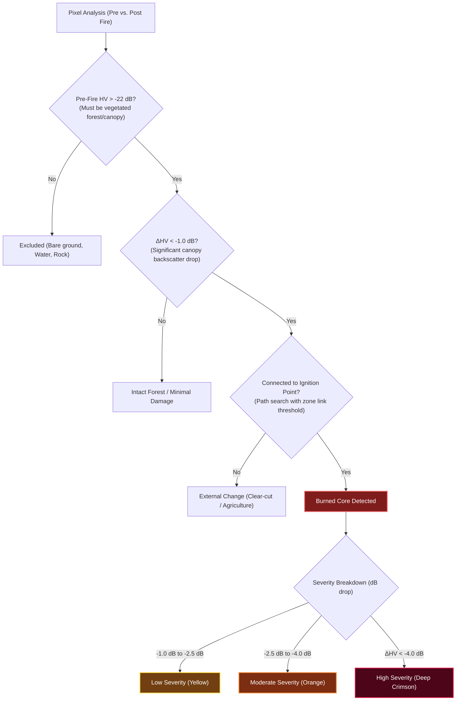
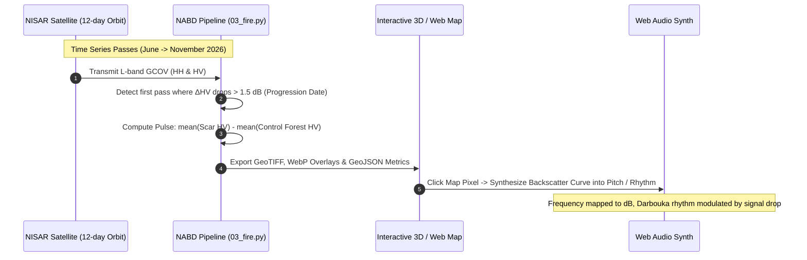

# NABD (نبض) — L'été de feu 2026 / Wildfire Monitoring with NISAR

**Live wildfire dashboard:** [nabd.earth](https://nabd.earth/)

> **NASA Space Apps Challenge 2026 · Challenge: *Dancing with the SARs***  
> Rapid Wildfire Scar Mapping, Severity Assessment, and Post-Fire Forest Recovery Tracking using **NASA-ISRO SAR (NISAR)** L-band Radar.

---

## 📌 Executive Summary

During the extreme Mediterranean heatwave of July–August 2026, catastrophic megafires burned over 1,000 km² across Southwestern Europe and North Africa. Optical satellites were often blinded by dense smoke plumes, aerosols, and night-time cloud cover.

**NABD (*"Pulse"* — نبض)** leverages **NISAR L-band SAR (~24 cm wavelength)** to pierce through smoke, ash, clouds, and darkness to reveal:
- **Where the fire struck:** Accurate pixel-level burn scars and consolidated fire perimeters.
- **Severity levels:** Quantitative assessment of canopy and branch destruction via cross-polarization drop ($\Delta\gamma^0_{\text{HV}}$ in dB).
- **Temporal Progression:** Tracking front propagation and active burn evolution across satellite passes.
- **Ecosystem Recovery ("The Forest Pulse"):** Differential multi-temporal tracking comparing burned scars against intact control forests.

### Monitored Wildfire Sites (July–August 2026)

| Target Zone | Country | Ignition / Contained Dates | Official Reported Damage | NISAR GCOV Granules |
| :--- | :---: | :---: | :--- | :--- |
| **Ávila – Burgohondo** | 🇪🇸 Spain | 22 Jul → 06 Aug 2026 | $\approx 50,000\text{ ha}$ (up to $77,000\text{ ha}$ with Madrid/Toledo) | 42 provisional + 3 validated (since Jan 2026) |
| **Gironde – Saumos / Le Porge** | 🇫🇷 France | 22 Jul → 02 Aug 2026 | $42,000\text{ ha}$ (Gironde Prefecture) | 49 provisional + 3 validated (since Nov 2025) |
| **Laânoussar – Sefrou** | 🇲🇦 Morocco | 31 Jul → 07 Aug 2026 | $480\text{ ha}$ (National Water & Forests Agency - ANEF) | $\approx 85$ provisional + 9 validated (since Jun 2026) |

---

## 🗺️ System Architecture & Workflow Diagrams

### End-to-End Pipeline Workflow



### Burn Scar & Severity Decision Tree



### Fire Progression & Forest Pulse Sonification



---

## 🔬 Scientific Methodology

### 1. Radar Physics of Forest Fires in L-Band
* **Volume Scattering Collapse:** In healthy forests, L-band radar waves (~24 cm) penetrate the foliage and scatter within the dense network of branches and trunks, producing high cross-polarization backscatter ($\gamma^0_{\text{HV}}$). When a fire consumes the canopy, needles fall, and wood loses moisture, volume scattering collapses dramatically, producing a multi-decibel drop.
* **Delayed Phenological Drop (The 10–120 Day Post-Fire Window):** Real NISAR observations demonstrate that the HV backscatter drop deepens for 2 to 3 months following fire containment as damaged needles desiccate and fall. Immediate post-fire observation drastically underestimates damage. NABD compares the median of acquisitions up to 75 days before against the median of 10 to 120 days post-fire:
  $$\Delta\gamma^0_{\text{HV}} = \text{median}\left(\gamma^0_{\text{HV, post}}\right) - \text{median}\left(\gamma^0_{\text{HV, pre}}\right)$$

### 2. Scene Calibration & Orbit Averaging
* **Unburned Reference Calibration:** Rain events or atmospheric moisture can artificially surge backscatter by $+2\text{ dB}$. Every single pass is inter-calibrated against invariant, unburned sections of the scene. Granules displaying calibration deviations $> 3\text{ dB}$ are automatically discarded.
* **Multi-Geometry Fusion:** Observations from multiple ascending and descending tracks are normalized and averaged, eliminating single-look geometric shadow or layover distortions.

### 3. Spatial Connectivity & Perimeter Consolidation
* **Clustering from Ignition:** To prevent false positives caused by seasonal harvesting or clear-cuts, NABD anchors analysis at verified ignition coordinates (`ignition`), capturing the primary scar and linking surrounding spot fires within a spatial link radius (`link_m`: 500 m to 2.5 km).
* **Official Perimeter Morphological Closing:** Gaps and unburned pockets smaller than 200 m inside the fire zone are closed to reconstruct the official operational perimeter reported by civil protection agencies.

### 4. Forest Recovery Pulse
* By continuously tracking:
  $$\text{Pulse}(t) = \overline{\gamma^0_{\text{HV, scar}}}(t) - \overline{\gamma^0_{\text{HV, control}}}(t)$$
  NABD eliminates seasonal phenological cycles and sensor re-calibrations, directly charting biological vegetation regrowth over months and years.

---

## 📁 Repository Structure

```text
nisar-surface-change/
├── data/
│   ├── facts.json              # Validated fire stats, casualties, response metadata
│   ├── inventory.json          # Spatial catalog bounds & acquisition summaries
│   ├── granules_*.csv          # NASA CMR search granules for Ávila, Gironde & Sefrou
│   ├── raw/                    # Downloaded GeoTIFFs & NISAR HDF5 datasets
│   └── work/                   # Analytical GeoTIFF outputs (dHV_dB.tif, severity.tif)
├── scripts/
│   ├── config.py               # Fire ignition coordinates, spatial bounds, dB thresholds
│   ├── common.py               # Radar reprojection, Lee filtering, display composers
│   ├── 00_make_demo.py         # Synthetic realistic test generator for offline testing
│   ├── 01_search.py            # NASA CMR API client for NISAR scenes
│   ├── 02_download.py          # NASA Harmony bounding box downloader / HDF5 streaming
│   ├── 03_fire.py              # Burn scar, severity, progression & pulse engine
│   └── 04_export.py            # Packaging artifacts into web/data/data.js
├── web/
│   ├── index.html              # Main Interactive Application (Leaflet, WebGL, Web Audio)
│   ├── intro/                  # 3D interactive prologue globe and textures
│   ├── data/                   # Packaged map layers (WebP) & data.js
│   └── vendor/                 # Three.js, Leaflet, and web dependencies
├── requirements.txt            # Python dependencies
└── README.md                   # Project documentation
```

---

## ⚡ Quickstart Guide

### 1. Environment Setup
```bash
# Clone the repository
git clone https://github.com/your-username/nisar-surface-change.git
cd nisar-surface-change

# Create and activate virtual environment
python -m venv .venv

# On Linux / macOS:
source .venv/bin/activate
# On Windows:
.venv\Scripts\activate

# Install dependencies
pip install -r requirements.txt
```

### 2. Earthdata Authentication
Accessing raw NISAR granules requires an approved [NASA Earthdata Login](https://urs.earthdata.nasa.gov/users/new).  
Save your credentials into `%USERPROFILE%\_netrc` (Windows) or `~/.netrc` (Linux/macOS):
```text
machine urs.earthdata.nasa.gov login <YOUR_USERNAME> password <YOUR_PASSWORD>
```

### 3. Pipeline Execution

```bash
# Step 0: (Optional) Generate synthetic data for offline dry-runs
python scripts/00_make_demo.py

# Step 1: Query NASA CMR catalog across all zones
python scripts/01_search.py --zone all

# Step 2: Download clipped bounding-box subsets (saves bandwidth vs 6GB full granules)
python scripts/02_download.py --zone sefrou --limit 2    # Quick test
python scripts/02_download.py --zone all                 # Full dataset

# Step 3: Run the fire analytical pipeline (burn scar, severity, progression, pulse)
python scripts/03_fire.py --zone all

# Step 4: Export web datasets and raster layers
python scripts/04_export.py

# Step 5: Start the web dashboard
python -m http.server 8000 -d web
```
Navigate to **`http://localhost:8000`** in your browser.

---

## 📊 Scientific Disclaimers & Known Limitations

1. **Provisional Calibration Releases:** Datasets acquired prior to October 21, 2026 are NISAR provisional evaluation products undergoing orbital refinement.
2. **Instrument Coverage Gaps:** A scheduled instrument gap occurred between July 27 and August 10, 2026. Combining multiple overlapping orbital tracks mitigates this gap.
3. **Topographic Distortion:** In steep mountainous terrain (such as the Middle Atlas in Sefrou or Sierra de Gredos in Ávila), radar layover and shadow can influence backscatter.
4. **Shrub & Understory vs. High Canopy:** In Ávila, significant portions burned through sparse scrubland and montane grasslands, which exhibit a lower L-band response than dense pine canopies. The radar captures ~60% of scrubland extent while capturing 92%–109% of dense pine and cedar forests in Gironde and Sefrou.

---

## 📜 Credits & License
Developed for the **NASA Space Apps Challenge 2026** under track *Dancing with the SARs*.  
NISAR data products provided by **NASA / ISRO** through the **Alaska Satellite Facility (ASF) DAAC**.
